# HomeDex — Historial de versiones / Version history

Cada versión tiene su texto en español y en inglés. / Each version has its notes in Spanish and English.

- **0.x** — desarrollo antes de publicar en GitHub / development before publishing on GitHub
- **1.x** — desde la publicación hasta las mejoras de seguridad / from publication to the security improvements
- **2.x** — desde las mejoras de seguridad hasta el medallero / from the security improvements to the medal case
- **3.x** — desde el medallero / since the medal case
- El tercer número (X.X.1, X.X.2…) marca mejoras menores o arreglos. / The third number (X.X.1, X.X.2…) marks minor improvements or fixes.
- Las imágenes de cada versión son capturas de prueba (carpeta `changelog/`), hechas con datos de prueba o de ejemplo. / Each version's images are test screenshots (`changelog/` folder), made with test or sample data.

---

## v3.6.2 — "Desmarcar todos" desmarca de verdad / "Unmark all" really unmarks (16/11/2026)

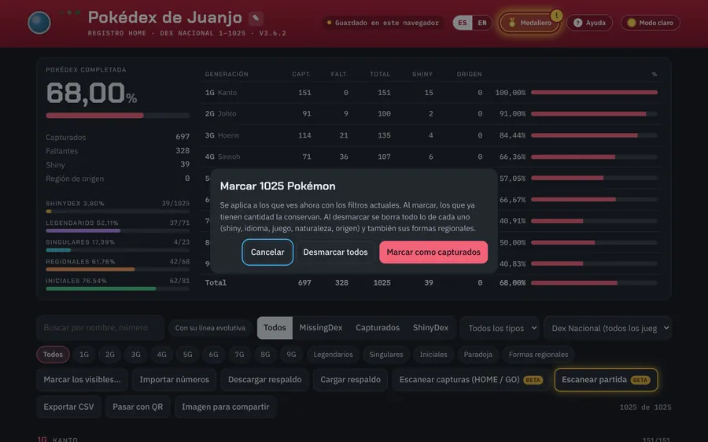 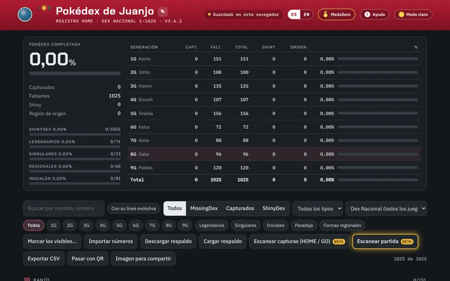

### Español
- **Arreglo:** "Marcar los visibles… → Desmarcar todos" sacaba el capturado pero dejaba el shiny, el idioma, el juego, la naturaleza y el origen. Quedaban shiny "sueltos" que no se contaban en ninguna parte, aunque un shiny implica tener el Pokémon. Ahora desmarcar borra todo lo de cada uno, igual que la casilla de la tarjeta.
- **Arreglo:** "Desmarcar todos" no tocaba las formas regionales, porque no se ven en la lista común. Ahora también desmarca las formas regionales de cada especie desmarcada.
- Al abrir la app se limpian solos los datos que hubieran quedado sueltos por ese error (shiny, idioma, juego, naturaleza u origen de un Pokémon no capturado).
- El aviso de "Marcar los visibles…" explica qué hace desmarcar.

### English
- **Fix:** "Mark visible… → Unmark all" removed the caught mark but left shiny, language, game, nature and origin. That left "loose" shinies that weren't counted anywhere, even though a shiny means you have the Pokémon. Unmarking now clears everything about each one, just like the card's checkbox.
- **Fix:** "Unmark all" didn't touch regional forms, since they don't show in the normal list. It now also unmarks the regional forms of every species it unmarks.
- When the app opens, any data left loose by that bug (shiny, language, game, nature or origin of a Pokémon that isn't caught) is cleaned up automatically.
- The "Mark visible…" dialog explains what unmarking does.

---

## v3.6.1 — "Eso no es un Pokémon" a la vista / "Not a Pokémon" in sight (16/11/2026)

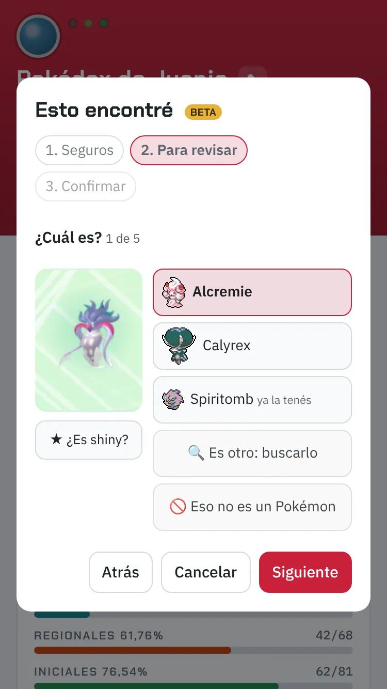

### Español
- En el paso **Para revisar**, "Es otro: buscarlo" y "Eso no es un Pokémon" quedan juntos, justo debajo de las tres opciones. Antes, "Eso no es un Pokémon" quedaba al final y en celulares chicos había que desplazarse para verlo, sobre todo con el buscador abierto.
- En el celular, el recorte de la captura va al costado de las opciones y más chico, así entra todo en la pantalla.
- Los botones de abajo (Atrás, Cancelar, Siguiente, Marcar) quedan siempre visibles.

### English
- In the **To review** step, "Another one: search" and "Not a Pokémon" sit together right below the three options. "Not a Pokémon" used to be at the end, and on small phones you had to scroll to see it, especially with the search open.
- On phones, the screenshot crop sits beside the options and smaller, so everything fits on screen.
- The bottom buttons (Back, Cancel, Next, Mark) always stay visible.

---

## v3.6.0 — Buscar, shiny y "no es un Pokémon" / Search, shiny and "not a Pokémon" (16/11/2026)

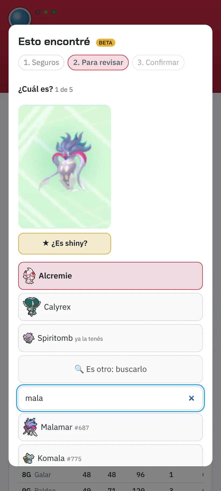 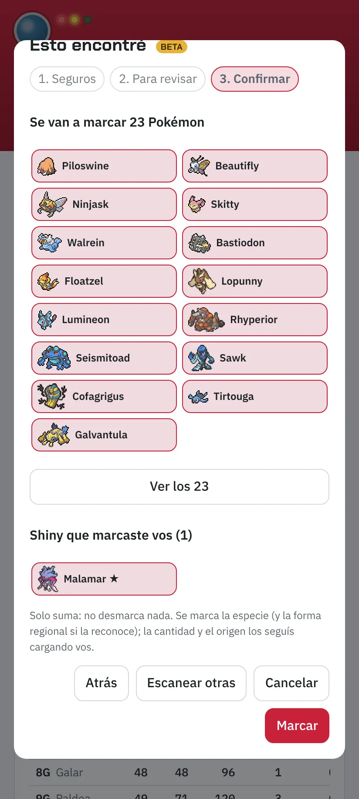

### Español
- En el paso **Para revisar** del escáner de capturas, además de las tres opciones:
  - **Es otro: buscarlo:** abre un buscador para elegir cualquier Pokémon o forma regional por nombre (en español o en inglés) o por número.
  - **¿Es shiny?:** botón para indicar que ese Pokémon es shiny; se marca como shiny al confirmar.
  - **Eso no es un Pokémon:** para cuando la app tomó un botón u otro dibujo de la pantalla como si fuera un Pokémon; pasa al siguiente sin marcar nada.
- En el paso **Confirmar** aparece la lista "Shiny que marcaste vos" con sus sprites.

### English
- In the scanner's **To review** step, besides the three options:
  - **It's another one: search:** opens a search box to pick any Pokémon or regional form by name (Spanish or English) or number.
  - **Is it shiny?:** a button to say that Pokémon is shiny; it's marked as shiny when you confirm.
  - **That's not a Pokémon:** for when the app took a button or another picture on the screen for a Pokémon; it moves on without marking anything.
- The **Confirm** step shows a "Shinies you marked" list with their sprites.

---

## v3.5.0 — Confirmación en tres pasos y sprites / Three-step confirmation and sprites (16/11/2026)

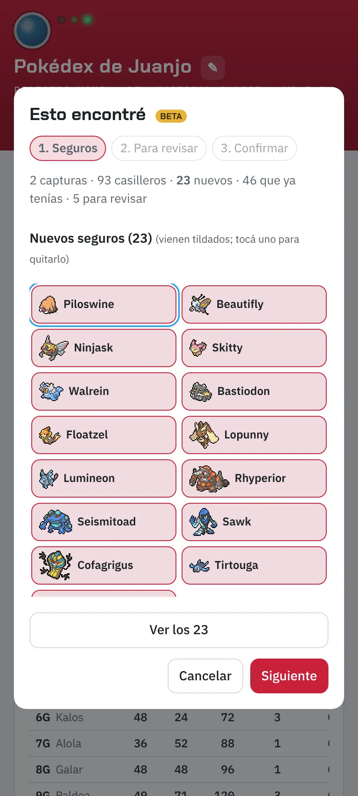 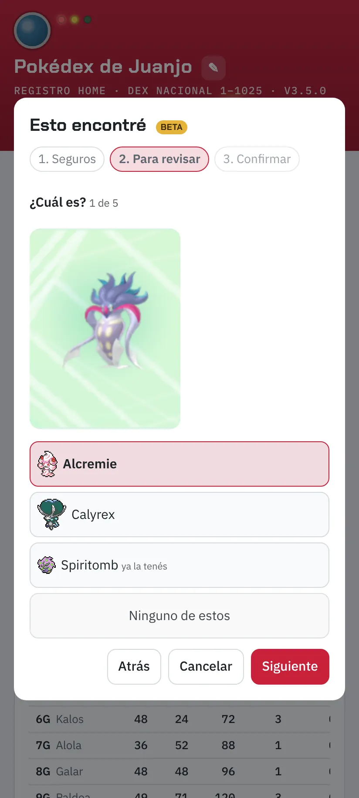 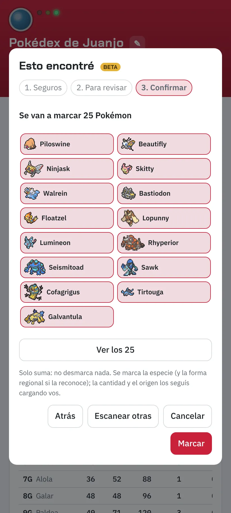

### Español
- **El escáner de capturas confirma en tres pasos:**
  1. **Seguros:** grilla con sprite y nombre de los Pokémon nuevos reconocidos con seguridad. Se ven los primeros 15 y un botón "Ver los N" despliega el resto. Vienen tildados; tocás uno para quitarlo.
  2. **Para revisar:** los dudosos de a uno, con el recorte grande de tu captura y hasta tres opciones con sprite, más "Ninguno de estos". Al elegir pasa solo al siguiente; un contador muestra cuántos faltan.
  3. **Confirmar:** resumen con los sprites de todo lo que se va a marcar, los shiny, el compañero (si hay medalla de mejor amigo de GO) y el botón Marcar.
- Los pasos que no hacen falta se saltean (por ejemplo, si no hay dudosos). Con "Atrás" se puede volver y cambiar cualquier elección.
- **Escanear partida** muestra sprites: arriba aparecen los nuevos para tu Pokédex y los shiny nuevos, y las listas de especies de cada partida también van con sprite (15 visibles y "Ver los N").
- Los sprites son los mismos de la Pokédex, así que no se descarga nada nuevo.

### English
- **The screenshot scanner confirms in three steps:**
  1. **Sure:** a grid with sprite and name of the new Pokémon recognised for sure. The first 15 are shown and a "See all N" button unfolds the rest. They come ticked; tap one to leave it out.
  2. **To review:** the doubtful ones one at a time, with a large crop of your screenshot and up to three options with sprites, plus "None of these". Choosing moves on to the next one; a counter shows how many are left.
  3. **Confirm:** a summary with the sprites of everything that will be marked, the shinies, the partner (if there is a GO best-buddy medal) and the Mark button.
- Steps that aren't needed are skipped (for example, when nothing is doubtful). "Back" lets you return and change any choice.
- **Scan save file** shows sprites: the new species for your Pokédex and the new shinies come first, and each save's species lists have sprites too (15 shown and "See all N").
- The sprites are the Pokédex's own, so nothing new is downloaded.

---

## v3.4.0 — Compañero desde GO y más marcas / Partner from GO and more badges (16/11/2026)

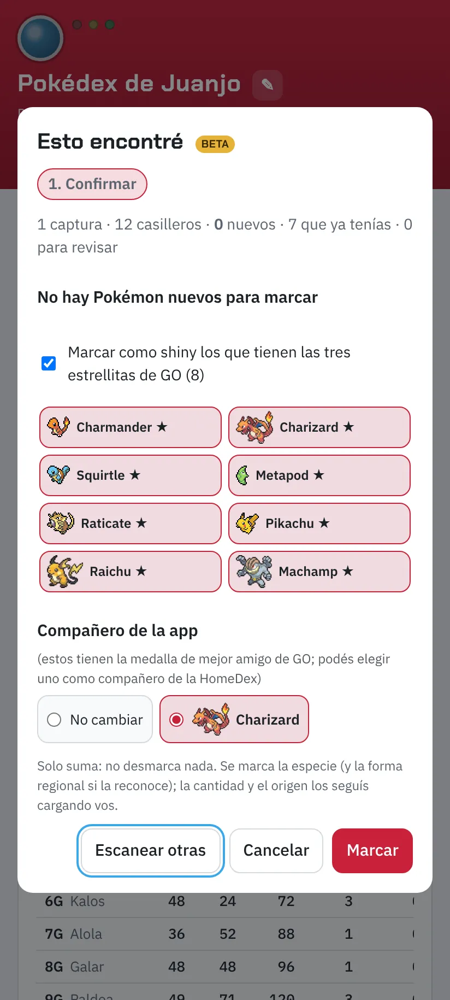

### Español
- **Nuevo: compañero desde GO.** Si una captura de GO tiene Pokémon con la medalla de mejor amigo, la pantalla de confirmación ofrece elegir uno como compañero de la HomeDex. Es opcional: por defecto queda "No cambiar".
- Los shiny de GO también se detectan cuando el reconocimiento está bastante seguro pero no del todo (por ejemplo, un Charizard shiny con gorra de evento).
- Se ignora también el globo celeste de los Pokémon de eventos de ciudad.
- **Arreglo:** el halo celeste que GO dibuja detrás de algunos Pokémon (por ejemplo, Meltan) se confundía con el Pokémon. Ahora se descuenta.
- GO se lee tres veces (normal, sensible y muy sensible) y se queda con la mejor lectura, lo que ayuda con los Pokémon claros.
- En las pruebas con 9 capturas reales de GO (shiny, oscuros, purificados, Dinamax, Gigamax, con suerte, con fondo y de eventos) reconoció bien 87 de 88 Pokémon, y todos los que marcó como seguros eran correctos. Detectó todos los shiny y el mejor amigo. Las capturas de HOME siguen igual (179 de 184).

### English
- **New: partner from GO.** If a GO screenshot has Pokémon with the best-buddy medal, the confirmation screen offers to pick one as your HomeDex partner. It's optional: "Don't change" is selected by default.
- GO shinies are also detected when recognition is fairly but not fully sure (for example, a shiny Charizard with an event cap).
- The light-blue globe of city-event Pokémon is ignored too.
- **Fix:** the light-cyan halo GO draws behind some Pokémon (for example, Meltan) was mistaken for part of the Pokémon. It is now left out.
- GO is read three times (normal, sensitive and very sensitive) and the best reading is kept, which helps with pale Pokémon.
- In tests with 9 real GO screenshots (shinies, shadow, purified, Dynamax, Gigantamax, lucky, special backgrounds and event Pokémon) it recognised 87 of 88 Pokémon correctly, and every one it marked as sure was right. It detected every shiny and the best buddy. HOME screenshots work as before (179 of 184).

---

## v3.3.0 — Shiny y marcas de Pokémon GO / Pokémon GO shinies and badges (16/11/2026)

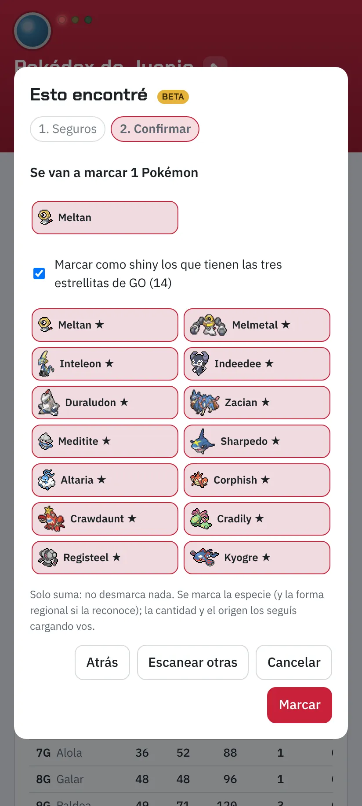

### Español
- **Shiny en GO:** el escáner detecta las tres estrellitas que GO pone junto al PC de los Pokémon shiny, y esos Pokémon vienen tildados para marcarse como shiny (podés destildarlos antes de confirmar).
- **Arreglo:** la versión anterior tomaba por shiny el ícono celeste de los Pokémon purificados. Ahora ese ícono se ignora.
- Se ignoran todas las demás marcas de GO, que no cambian la Pokédex: estrella de favorito, fondo dorado de Pokémon con suerte, llama violeta de Pokémon oscuro, ícono de purificado, X de Dinamax o Gigamax y flores de fondo especial.
- Mejor con Pokémon con suerte: los círculos dorados del fondo ya no se mezclan con el dibujo.
- Lee también recortes de la lista de GO con una sola fila y la fila de arriba aunque esté cortada.
- Los botones redondos de abajo solo se tienen en cuenta en la parte de abajo de la pantalla, así que Pokémon de color turquesa (como Venusaur) ya no se toman por tapados.
- En las pruebas con capturas reales de GO reconoció bien 35 de 36 Pokémon, incluido el shiny; el que falló (un Swablu con suerte, blanco sobre blanco) quedó para revisar. Las capturas de HOME siguen igual (179 de 184).

### English
- **GO shinies:** the scanner detects the three sparkles GO shows next to the CP of shiny Pokémon, and those come ticked to be marked as shiny (you can untick them before confirming).
- **Fix:** the previous version took the light-blue purified icon for shiny. That icon is now ignored.
- All other GO badges, which don't change the Pokédex, are ignored: favourite star, lucky golden background, shadow purple flame, purified icon, Dynamax or Gigantamax X and special-background flowers.
- Better with lucky Pokémon: the golden circles behind them no longer get mixed into the picture.
- It also reads crops of the GO list with a single row, and the top row even if it is cut.
- The round buttons at the bottom are only considered at the bottom of the screen, so teal Pokémon (like Venusaur) are no longer taken as covered.
- In tests with real GO screenshots it recognised 35 of 36 Pokémon correctly, the shiny included; the one it missed (a lucky Swablu, white on white) went to the review list. HOME screenshots work as before (179 of 184).

---

## v3.2.1 — HOME con 3 a 7 columnas / HOME with 3 to 7 columns (16/11/2026)

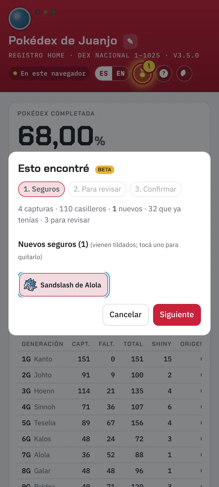

### Español
- El escáner reconoce las capturas de HOME con cualquier cantidad de columnas (de 3 a 7), también cuando HOME muestra el nombre o el número debajo de cada Pokémon.
- Ignora la estrella de favorito de HOME y las etiquetas de nombre y número, que antes podían confundir el reconocimiento.
- Mejor con Pokémon muy claros (por ejemplo, Nidoran♀ o las formas de Alola de hielo): se prueba una segunda lectura más sensible y se queda con la mejor.
- También lee la última fila aunque la captura la corte un poco.
- Las capturas de HOME ya no se confunden con capturas de GO.
- En las pruebas con capturas reales de 3, 4, 5, 6 y 7 columnas reconoció bien 162 de 165 Pokémon, y todos los que marcó como seguros eran correctos.

### English
- The scanner reads HOME screenshots with any number of columns (3 to 7), also when HOME shows the name or number under each Pokémon.
- It ignores HOME's favourite star and the name and number labels, which could confuse recognition before.
- Better with very pale Pokémon (for example, Nidoran♀ or the icy Alolan forms): a second, more sensitive reading is tried and the better one is kept.
- It also reads the last row even if the screenshot cuts it a little.
- HOME screenshots are no longer mistaken for GO screenshots.
- In tests with real screenshots of 3, 4, 5, 6 and 7 columns it recognised 162 of 165 Pokémon correctly, and every one it marked as sure was right.

---

## v3.2.0 — Escanear capturas de Pokémon GO / Scan Pokémon GO screenshots (16/11/2026)

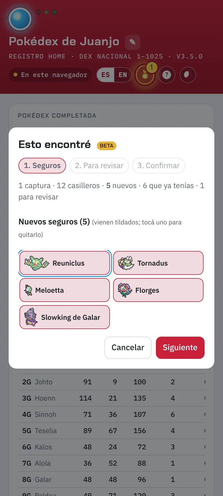

### Español
- **Nuevo (beta): el escáner de capturas ahora también lee Pokémon GO.** El botón pasa a llamarse *Escanear capturas (HOME / GO)* y acepta capturas de los dos juegos mezcladas.
- En GO se reconoce el dibujo de cada Pokémon comparándolo con los modelos del propio GO, así que los apodos no molestan. Incluye formas regionales y disfraces de eventos (se marca la especie).
- La app distingue sola si la captura es de HOME o de GO: en GO usa la barrita verde de debajo del nombre para ubicar cada Pokémon.
- Detecta el ícono de destello que GO pone junto a algunos Pokémon y ofrece marcarlos como shiny, sin tildar.
- Los íconos de compañero, estrellas e insignias que GO dibuja alrededor del Pokémon se ignoran.
- Las imágenes de referencia de GO (alrededor de 1 MB) se descargan solo la primera vez que escaneás una captura de GO.
- Cuestan más los Pokémon con fondo de suerte o de evento, los muy claros y las capturas de baja resolución (por ejemplo, reenviadas por chat): suelen ir a la lista para revisar.

### English
- **New (beta): the screenshot scanner now reads Pokémon GO too.** The button is now *Scan screenshots (HOME / GO)* and takes screenshots of both games mixed together.
- In GO each Pokémon's picture is compared with GO's own models, so nicknames don't matter. Regional forms and event costumes are included (the species is marked).
- The app tells by itself whether a screenshot is from HOME or GO: in GO it uses the small green bar under the name to find each Pokémon.
- It detects the sparkle icon GO shows next to some Pokémon and offers to mark them as shiny, unticked.
- The buddy, star and badge icons GO draws around the Pokémon are ignored.
- GO's reference pictures (about 1 MB) download only the first time you scan a GO screenshot.
- Harder cases: Pokémon with lucky or event backgrounds, very pale ones, and low-resolution screenshots (for example, forwarded through a chat app). They usually go to the review list.

---

## v3.1.0 — Escanear capturas de HOME / Scan HOME screenshots (16/11/2026)

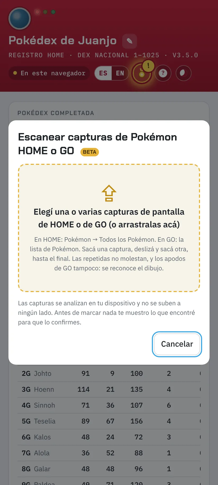 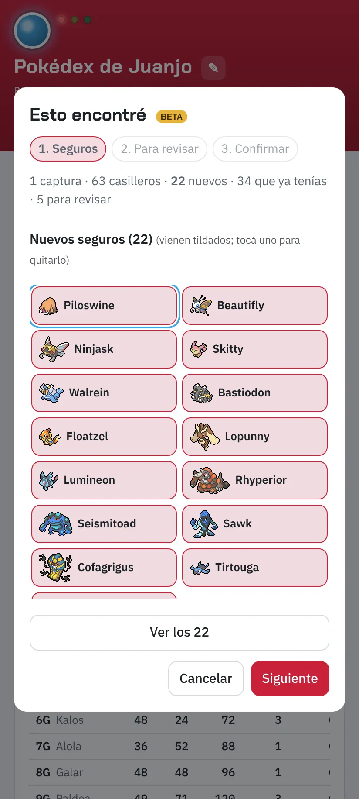

### Español
- **Nuevo (beta): Escanear capturas de HOME.** Elegís una o varias capturas de la lista *Pokémon → Todos los Pokémon* de Pokémon HOME y la app reconoce cada Pokémon por su dibujo, incluidas las formas regionales.
- Funciona sin servidor: las capturas se analizan en tu dispositivo y no se suben a ningún lado. Las imágenes de referencia (alrededor de 1 MB) se descargan solo la primera vez que usás la función y después quedan guardadas para usarla sin conexión.
- Antes de marcar nada aparece una lista para confirmar: los reconocidos con seguridad vienen tildados; los dudosos ofrecen hasta tres opciones (si la app está bastante segura, ya viene elegida la más probable). Solo suma: no desmarca nada.
- Detecta sola la grilla de la captura, saltea los casilleros vacíos o cortados y no repite los Pokémon que aparecen en varias capturas.
- Los shiny no se distinguen con seguridad: se sugieren sin tildar. Los casilleros tapados por los botones redondos de HOME se marcan como dudosos.
- Las capturas que no son de HOME (por ejemplo, de Pokémon GO) se avisan y se saltean.
- **Arreglo:** la lista de scripts permitidos de la versión publicada (`vercel.json`) no se había actualizado desde la 2.2.3, así que en las versiones 3.0.0 a 3.0.2 el navegador podía bloquear el código de la página. Ahora se calcula sola en cada versión.

### English
- **New (beta): Scan HOME screenshots.** Choose one or more screenshots of the *Pokémon → All Pokémon* list in Pokémon HOME and the app recognises each Pokémon from its picture, regional forms included.
- No server needed: screenshots are analysed on your device and are not uploaded anywhere. The reference pictures (about 1 MB) download only the first time you use it and are then kept for offline use.
- Before anything is marked you get a list to confirm: sure matches come ticked; doubtful ones offer up to three options (when the app is fairly sure, the likeliest one comes picked). It only adds: nothing gets unmarked.
- It finds the screenshot's grid by itself, skips empty or cut-off slots and doesn't repeat Pokémon that appear in several screenshots.
- Shinies can't be told apart reliably: they are suggested, unticked. Slots covered by HOME's round buttons are listed as doubtful.
- Screenshots that are not from HOME (for example, Pokémon GO) are reported and skipped.
- **Fix:** the list of allowed scripts in the published version (`vercel.json`) had not been updated since 2.2.3, so in versions 3.0.0 to 3.0.2 the browser could block the page's code. It is now computed automatically for every version.

---

## v3.0.2 — Filtros rápidos otra vez / Fast filters again (13/11/2026)

### Español
- **Arreglo:** en la copia que funciona sin conexión, quitar un filtro especial (Legendarios, Singulares, Iniciales…) o combinarlo con otro podía trabar la página varios segundos.
- La causa era que las imágenes de íconos y medallas iban dentro de la página como texto muy largo, y el navegador lo volvía a leer cada vez que redibujaba. Ahora se cargan una sola vez como imagen.
- Con ese cambio, redibujar toda la lista pasa de unos 5 segundos a menos de un cuarto de segundo.

### English
- **Fix:** in the copy that works offline, removing a special filter (Legendary, Mythical, Starters…) or combining it with another could freeze the page for several seconds.
- The cause was that the icon and medal images were stored inside the page as very long text, and the browser re-read it on every redraw. Now they load once as an image.
- With that change, redrawing the whole list goes from about 5 seconds to under a quarter of a second.

---

## v3.0.1 — Medallero más liviano / Lighter medal case (13/11/2026)

### Español
- Las medallas se recalculan solo cuando cambian tus datos: al marcar o desmarcar un Pokémon, al cargar un respaldo o al traer los datos de tu cuenta. Los filtros y la búsqueda ya no las tocan.
- El cálculo espera un instante después de marcar, así la casilla responde al momento.
- El estado de las medallas se guarda solo cuando cambia.
- El brillo del botón Medallero late unas pocas veces y después queda quieto, en lugar de animarse sin parar.

### English
- Medals are recalculated only when your data changes: marking or unmarking a Pokémon, loading a backup or fetching your account data. Filters and search no longer touch them.
- The calculation waits a moment after you mark something, so the checkbox responds right away.
- The medal state is saved only when it changes.
- The Medals button glow pulses a few times and then stays still, instead of animating nonstop.

---

## v3.0.0 — Medallero / Medal case (13/11/2026)

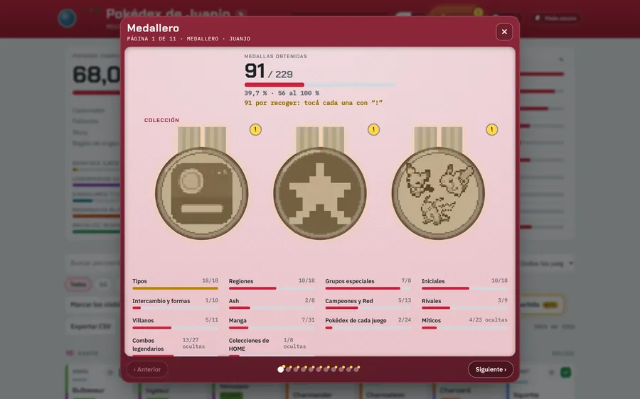 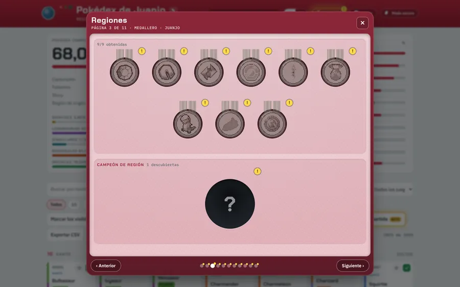

### Español
- **Medallero nuevo:** 229 medallas que se ganan solas a medida que completás la Pokédex. Las categorías son colección, shiny, familias, tipos, regiones, grupos especiales, iniciales, intercambio y formas, Ash, campeones y Red, rivales, villanos, el manga Pokémon Adventures y la Pokédex de cada juego.
- **Medallas con niveles:** van de Bronce a Platino pasando por Plata, Rubí, Zafiro, Esmeralda, Oro y Diamante. Cada nivel tiene su título; por ejemplo, la de Colección va de "¿Eres chico o chica?" a "Maestro Pokémon". Al 100 % llevan roseta dorada.
- **Medallas únicas:** llevan una roseta de color según la categoría: roja, azul o verde.
- **Medallas ocultas:** míticos, combos legendarios, colecciones de HOME, el 100 % de cada región y las líneas completas de iniciales no se muestran hasta ganarlas. En la última página se puede revelar la misión de cada una.
- **Botón Medallero:** está en la barra de arriba y muestra **!** cuando hay medallas nuevas. Se recogen tocándolas en el estuche, con una animación de giro. Una sola vez alcanza aunque la medalla haya subido varios niveles.
- **Ficha de cada medalla:** al pasar el mouse o tocarla muestra el título, el logro o lo que falta, y un botón con la próxima misión.
- **Aviso al ganar medallas:** al marcar un Pokémon que te da medallas nuevas, aparece un único aviso animado, aunque ganes varias juntas.
- **Colores:** el estuche toma los colores del compañero; sin compañero, usa el rojo de HomeDex. Respeta el modo oscuro y la opción de reducir movimiento.
- **Imágenes:** las medallas están en una sola imagen nueva, `medals.png`, de 246 KB.

### English
- **New medal case:** 229 medals earned automatically as you complete your dex. The categories are collection, shiny, families, types, regions, special groups, starters, trades and forms, Ash, champions and Red, rivals, villains, the Pokémon Adventures manga and each game's dex.
- **Medals with levels:** they go from Bronze to Platinum through Silver, Ruby, Sapphire, Emerald, Gold and Diamond. Each level has its own title; for example, the Collection medal goes from "Are you a boy or a girl?" to "Pokémon Master". At 100% they get a golden rosette.
- **Single medals:** they get a rosette colored by category: red, blue or green.
- **Hidden medals:** mythicals, legendary combos, HOME collections, 100% of each region and full starter lines stay hidden until earned. On the last page you can reveal each one's mission.
- **Medals button:** it sits in the top bar and shows **!** when there are new medals. You collect them by tapping them in the case, with a flip animation. One tap is enough even if the medal went up several levels.
- **Medal details:** hovering over or tapping a medal shows its title, the achievement or what is missing, and a button with the next mission.
- **New-medal notice:** marking a Pokémon that earns new medals shows a single animated notice, even if you earn several at once.
- **Colors:** the case takes the partner's colors; with no partner, it uses HomeDex red. It respects dark mode and the reduced-motion setting.
- **Images:** the medals live in one new image, `medals.png`, 246 KB.

---

## v2.2.3 — Íconos de 9.ª generación / Gen 9 icons (19/10/2026)

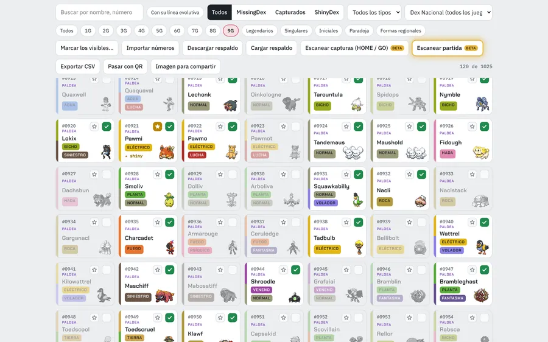

### Español
- **Íconos para las 127 especies que no tenían:** las 120 de 9.ª generación y las 7 de Hisui (Wyrdeer, Kleavor, Ursaluna, Basculegion, Sneasler, Overqwil y Enamorus).
- Las 23 formas regionales que mostraban el ícono de su especie base ahora tienen el propio (por ejemplo, los tres Tauros de Paldea).
- Origen: sprites en pixel art del repositorio de sprites de PokeAPI, el mismo de los demás íconos.
- La imagen con todos los íconos pasa de 243 KB a 375 KB.

### English
- **Icons for the 127 species that had none:** the 120 from Gen 9 and the 7 from Hisui (Wyrdeer, Kleavor, Ursaluna, Basculegion, Sneasler, Overqwil and Enamorus).
- The 23 regional forms that showed their base species' icon now have their own (for example, the three Paldean Tauros).
- Source: pixel-art sprites from the PokeAPI sprites repository, the same as the other icons.
- The image holding all the icons grows from 243 KB to 375 KB.

---

## v2.2.2 — Filtros en el celular / Filters on phones (17/10/2026)

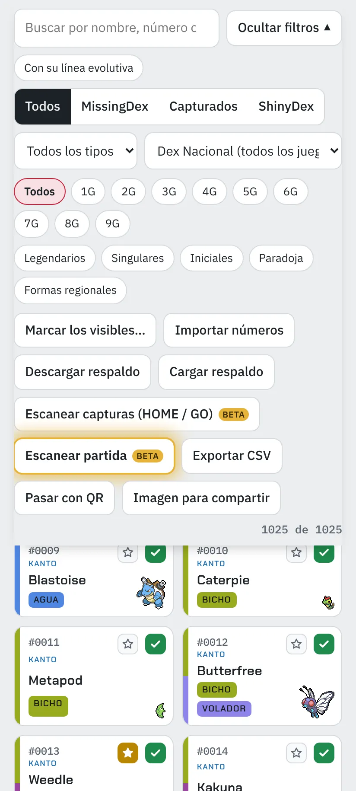

### Español
- El botón **Filtros** muestra u oculta los filtros. Abiertos, quedan fijos arriba como un bloque, debajo del buscador.
- Al bajar por la lista, el bloque se pliega solo y queda nada más que la barra con el buscador y el botón.
- Al abrir o cerrar los filtros, las tarjetas no se mueven de lugar.
- Arreglo: en iPhone el panel abierto se corría hacia los costados y cortaba los textos.

### English
- The **Filters** button shows or hides the filters. When open, they stay fixed at the top as a block, under the search box.
- Scrolling down the list folds the block away, leaving just the bar with the search box and the button.
- Opening or closing the filters no longer moves the cards.
- Fix: on iPhone the open panel shifted sideways and cut off the text.

---

## v2.2.1 — Arreglos en celulares e instalación en iPhone / Phone fixes and iPhone install (15/10/2026)

### Español
- **Filtros en el celular:** al abrir "Filtros" después de bajar por la lista, el panel aparecía fuera de la pantalla. Ahora se abre donde estás, se desplaza por dentro y el buscador con el botón "Ocultar filtros" queda siempre a la vista.
- **Celular en horizontal:** los filtros ocupaban casi toda la pantalla y no se podían ocultar. Ahora se pliegan igual que en vertical.
- **Instalar en iPhone y iPad:** Safari no ofrece el aviso de instalación que muestran Android y Chrome, así que el botón "Instalar app" ahora aparece también en iOS y explica los pasos (Compartir → Agregar a inicio).
- Aviso en esos pasos: en iPhone la app instalada guarda sus datos aparte de Safari; se ofrece descargar el respaldo para cargarlo después dentro de la app.
- Etiquetas para que iOS la abra como app a pantalla completa, con el nombre "HomeDex".

### English
- **Filters on phones:** opening "Filters" after scrolling down the list showed the panel off-screen. It now opens where you are, scrolls inside itself, and the search box with the "Hide filters" button always stays in view.
- **Phones in landscape:** the filters took up almost the whole screen and could not be hidden. They now fold just like in portrait.
- **Install on iPhone and iPad:** Safari does not offer the install prompt that Android and Chrome show, so the "Install app" button now also appears on iOS and explains the steps (Share → Add to Home Screen).
- Note in those steps: on iPhone the installed app keeps its data separate from Safari; it offers to download a backup to load afterwards inside the app.
- Tags so iOS opens it as a full-screen app named "HomeDex".

---

## v2.2.0 — Íconos en pixel art / Pixel-art icons (15/10/2026)

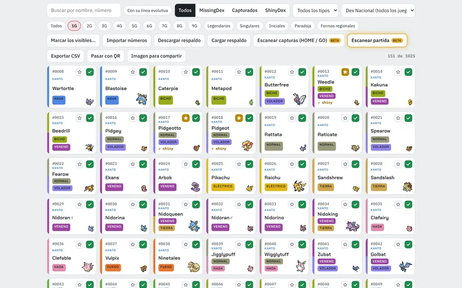

### Español
- **Íconos en pixel art** de cada Pokémon (del repositorio de sprites de PokeAPI, generaciones 7 y 8):
  - en cada tarjeta de la Pokédex (en gris los que te faltan);
  - en la ficha de cada Pokémon, ampliado sin perder nitidez;
  - en el botón del compañero, en la lista para elegirlo y en la imagen para compartir.
- La estrella de shiny pasó a estar al lado del tilde de capturado, para dejarle lugar al ícono.
- Los sprites grandes, la versión shiny y el enlace en alta definición siguen disponibles en la ficha.
- Todos los íconos viajan en una sola imagen de 243 KB, que queda guardada para usar sin conexión.
- Pendiente: las especies de 9.ª generación todavía no tienen ícono en el repositorio; 23 formas regionales muestran el de su especie base.

### English
- **Pixel-art icons** for every Pokémon (from the PokeAPI sprites repository, generations 7 and 8):
  - on every Pokédex card (greyed out when missing);
  - on each Pokémon's entry, enlarged without losing sharpness;
  - on the partner button, the partner picker and the share image.
- The shiny star now sits next to the caught tick, to make room for the icon.
- Large sprites, the shiny version and the high-definition link are still available in the entry.
- All icons ship as a single 243 KB image, kept for offline use.
- Pending: Gen 9 species have no icon in the repository yet; 23 regional forms show their base species' icon.

---

## v2.1.0 — QR, imagen para compartir y app instalable / QR, share image and installable app (15/10/2026)

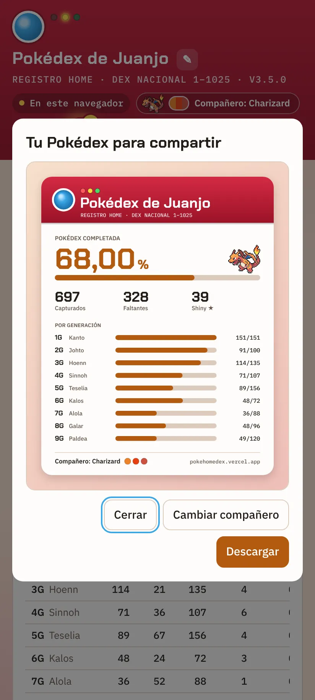 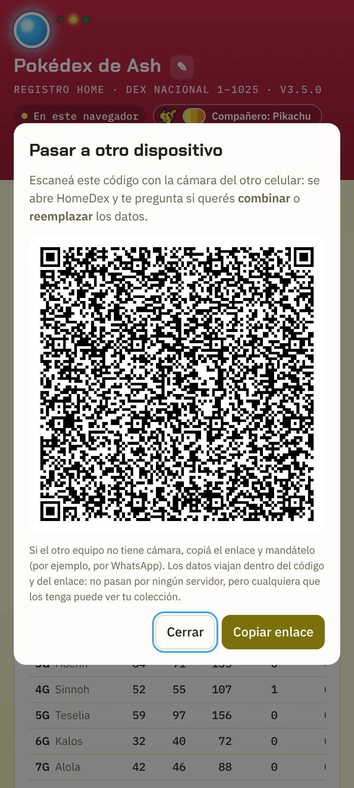

### Español
- **Pasar con QR:** genera un código con toda tu colección. Al escanearlo con la cámara de otro celular se abre HomeDex y pregunta si combinar o reemplazar. También se puede copiar o compartir el enlace. Los datos viajan dentro del código, sin servidores.
- **Imagen para compartir:** una Pokédex con tu nombre, porcentaje completado, capturados, faltantes, shiny y avance por generación, con los colores de tu compañero. Si no tenés compañero, te ofrece elegir uno o seguir con el rojo clásico. Se descarga o se comparte directo.
- **Instalable como app (PWA):** botón "Instalar app" en Android y PC. Funciona sin internet y se actualiza sola.
- **Recordatorio de respaldo:** si pasan 30 días sin descargar un respaldo, aparece un aviso con un botón para hacerlo.
- **Aviso de privacidad** al pie de la página y en la Ayuda.
- **Tipografías propias:** ya no se cargan desde Google Fonts.
- Ayuda: nuevas secciones sobre QR, imagen para compartir, instalación y privacidad.

### English
- **Move with QR:** builds a code with your whole collection. Scanning it with another phone's camera opens HomeDex and asks whether to merge or replace. The link can also be copied or shared. The data travels inside the code, through no server.
- **Share image:** a Pokédex with your name, completion percentage, caught, missing, shinies and progress by generation, in your partner's colours. With no partner chosen, it offers to pick one or keep the classic red. Download it or share it directly.
- **Installable app (PWA):** "Install app" button on Android and PC. Works offline and updates itself.
- **Backup reminder:** after 30 days without downloading a backup, a notice offers to do it.
- **Privacy notice** in the footer and in Help.
- **Self-hosted fonts:** no longer loaded from Google Fonts.
- Help: new sections on QR, share image, installing and privacy.

---

## v2.0.0 — Seguridad / Security (14/10/2026)

### Español
- **Cabeceras de seguridad** (`vercel.json`): política de contenido que solo permite los scripts propios de la página, bloqueo de incrustación en otros sitios y de permisos que la app no usa (cámara, micrófono, ubicación, etc.).
- Refuerzo en la forma de mostrar textos que vienen de archivos externos.
- El archivo de Pokémon GO se acepta hasta 5 MB.
- Nuevo `SECURITY.md` con qué datos maneja HomeDex, qué medidas tiene y cómo reportar un problema.
- Desde esta versión, `index.html` y `vercel.json` se generan juntos y deben subirse juntos.

### English
- **Security headers** (`vercel.json`): a content policy that only allows the page's own scripts, blocks embedding in other sites and permissions the app does not use (camera, microphone, location, etc.).
- Hardened display of text coming from external files.
- The Pokémon GO file is accepted up to 5 MB.
- New `SECURITY.md` describing what data HomeDex handles, its safeguards and how to report a problem.
- From this version on, `index.html` and `vercel.json` are generated together and must be uploaded together.

---

## v1.3.0 — Escanear partida / Scan save file (14/10/2026)

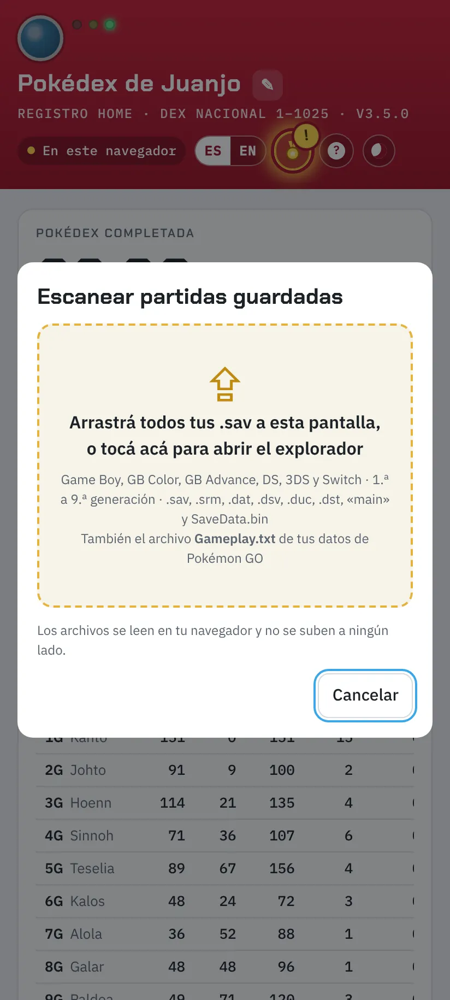 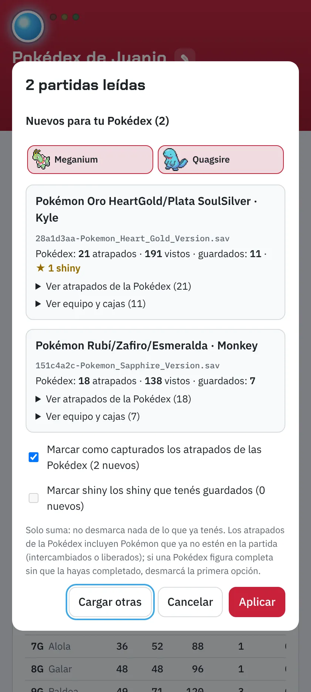

### Español
- **Escanear partida (Beta):** lee partidas guardadas y marca lo que tenés. Se pueden arrastrar varios archivos a la vez o elegirlos desde el explorador.
  - **Game Boy / Color:** Rojo, Azul, Amarillo, Oro, Plata, Cristal.
  - **Game Boy Advance:** Rubí, Zafiro, Esmeralda, Rojo Fuego, Verde Hoja.
  - **Nintendo DS:** Diamante, Perla, Platino, Oro HeartGold, Plata SoulSilver, Negro, Blanco, Negro 2, Blanco 2.
  - **Nintendo 3DS:** X, Y, Rubí Omega, Zafiro Alfa, Ultrasol, Ultraluna (Sol y Luna sin probar con partidas reales).
  - **Nintendo Switch:** Diamante Brillante, Perla Reluciente, Leyendas: Arceus, Escarlata, Púrpura, Leyendas: Z-A (en estos cuatro últimos se toman los Pokémon guardados, no la Pokédex).
  - Formatos de emulador y de Action Replay (`.sav`, `.srm`, `.dat`, `.dsv`, `.dst`, `.duc`) y el archivo `main` de 3DS/Switch.
  - Muestra Pokédex, equipo, cajas y shiny de cada partida; solo suma, nunca desmarca.
  - Aviso cuando una partida parece modificada con trucos.
- **Pokémon GO (Beta):** lee el `Gameplay.txt` de los datos personales que entrega Niantic.
- Número de versión visible arriba y al pie de la página.
- Ayuda actualizada con GIFs de ejemplo.

### English
- **Scan save file (Beta):** reads save files and marks what you have. Drop several files at once or pick them from the file browser.
  - **Game Boy / Color:** Red, Blue, Yellow, Gold, Silver, Crystal.
  - **Game Boy Advance:** Ruby, Sapphire, Emerald, FireRed, LeafGreen.
  - **Nintendo DS:** Diamond, Pearl, Platinum, HeartGold, SoulSilver, Black, White, Black 2, White 2.
  - **Nintendo 3DS:** X, Y, Omega Ruby, Alpha Sapphire, Ultra Sun, Ultra Moon (Sun and Moon not yet tested with real saves).
  - **Nintendo Switch:** Brilliant Diamond, Shining Pearl, Legends: Arceus, Scarlet, Violet, Legends: Z-A (for the last four, stored Pokémon are used, not the Pokédex).
  - Emulator and Action Replay formats (`.sav`, `.srm`, `.dat`, `.dsv`, `.dst`, `.duc`) and the 3DS/Switch `main` file.
  - Shows each save's Pokédex, party, boxes and shinies; it only adds, never unmarks.
  - Warning when a save looks modified with cheats.
- **Pokémon GO (Beta):** reads the `Gameplay.txt` from the personal data Niantic provides.
- Version number shown at the top and in the footer.
- Help updated with example GIFs.

---

## v1.2.0 — Búsqueda y segundo tipo / Search and second type (09/10/2026)

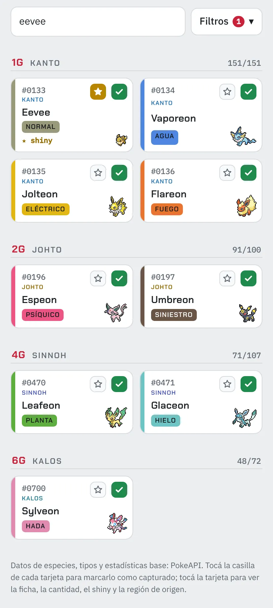 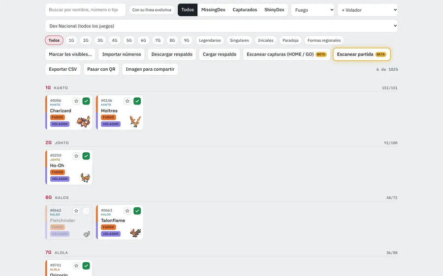

### Español
- **Segundo tipo opcional** en el filtro (el orden de los dos tipos da igual).
- **Buscador ampliado:** además del nombre, acepta el número de la Pokédex Nacional (las formas regionales aparecen con su especie) o el nombre de un tipo.
- **"Con su línea evolutiva":** muestra también las preevoluciones y evoluciones de lo que buscás.

### English
- **Optional second type** in the filter (the order of the two types does not matter).
- **Wider search:** besides the name, it takes the National Dex number (regional forms show up with their species) or a type name.
- **"With its evolution line":** also shows the pre-evolutions and evolutions of what you search for.

---

## v1.1.2 — Nombres de lugares completos / Complete location names (06/10/2026)

### Español
- Completados los nombres en español de los lugares que todavía faltaban en las ubicaciones de los juegos más viejos.

### English
- Filled in the Spanish names of the locations still missing for the older games.

---

## v1.1.1 — Ubicaciones traducidas / Translated locations (06/10/2026)

### Español
- Ubicaciones de Diamante Brillante/Perla Reluciente, Leyendas: Arceus, Escarlata/Púrpura y Leyendas: Z-A traducidas al inglés.
- Nombres en español de los lugares de Let's Go Pikachu/Eevee.

### English
- Locations for Brilliant Diamond/Shining Pearl, Legends: Arceus, Scarlet/Violet and Legends: Z-A translated into English.
- Spanish names for the Let's Go Pikachu/Eevee locations.

---

## v1.1.0 — Español / English (06/10/2026)

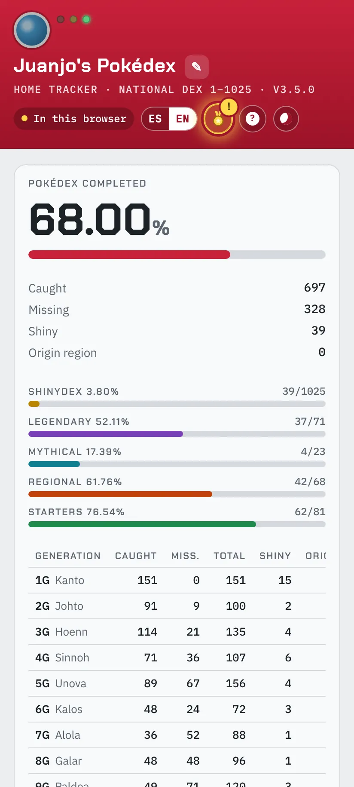

### Español
- **Selector ES | EN** en el encabezado: toda la interfaz, la ayuda y los datos (nombres de Pokémon, tipos, juegos, cómo conseguirlo en Pokémon GO) en español o en inglés.
- El buscador acepta nombres en los dos idiomas.

### English
- **ES | EN switch** in the header: the whole interface, the help and the data (Pokémon names, types, games, how to get it in Pokémon GO) in Spanish or English.
- Search accepts names in both languages.

---

## v1.0.2 — Ajustes de diseño / Layout tweaks (06/10/2026)

### Español
- Los contadores de cada tarjeta entran en una sola línea.
- Textos legales del pie de página a todo el ancho.

### English
- Each card's counters fit on a single line.
- Footer legal notes span the full width.

---

## v1.0.1 — Estadísticas de visitas / Visit statistics (06/10/2026)

### Español
- Vercel Analytics para contar visitas a la página. No registra lo que cada persona marca.

### English
- Vercel Analytics to count page visits. It does not record what each person marks.

---

## v1.0.0 — Publicación / Public release (06/10/2026)

### Español
- Primera versión publicada en GitHub y Vercel: https://pokehomedex.vercel.app
- Incluye todo lo hecho en las versiones 0.x.

### English
- First version published on GitHub and Vercel: https://pokehomedex.vercel.app
- Includes everything built in the 0.x versions.

---

## v0.8 — Resumen y Ayuda / Summary and Help (06/10/2026)

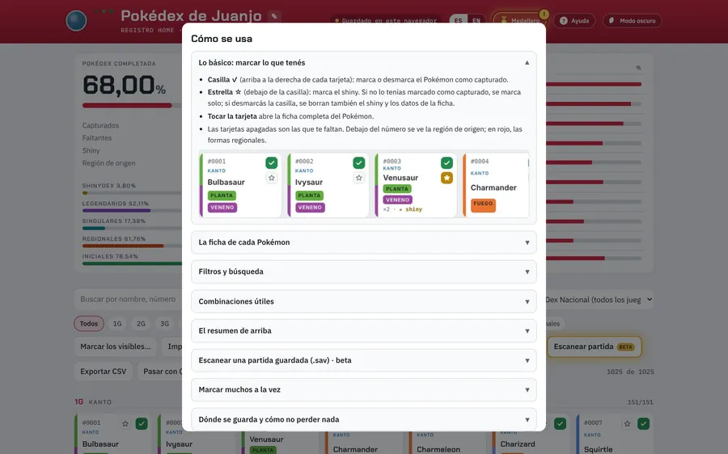 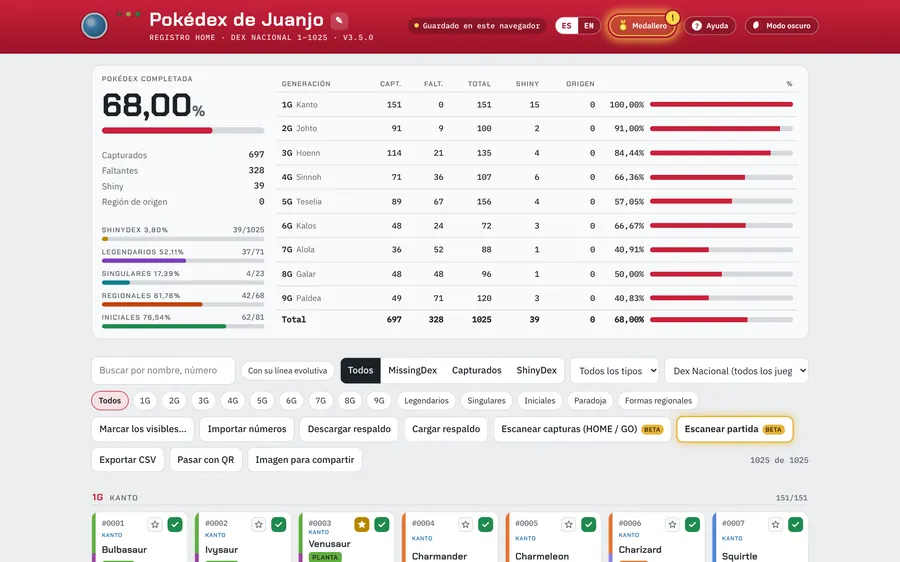

### Español
- Resumen con Legendarios, Singulares, Regionales e Iniciales.
- Tabla por generación con dos decimales y barras de avance.
- Botón de **Ayuda** con guías: lo básico, la ficha, filtros y búsqueda, combinaciones útiles y el resumen.
- Ícono de la pestaña (favicon).

### English
- Summary with Legendaries, Mythicals, Regionals and Starters.
- Generation table with two decimals and progress bars.
- **Help** button with guides: the basics, the entry, filters and search, useful combinations and the summary.
- Tab icon (favicon).

---

## v0.7 — Dónde encontrarlos / Where to find them (06/10/2026)

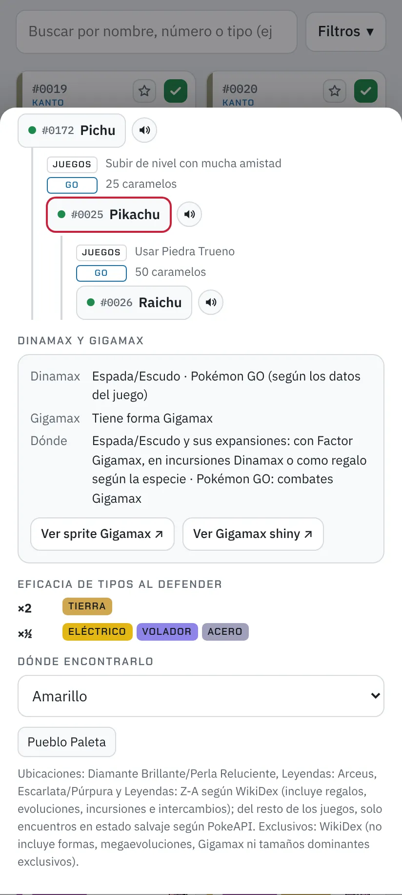

### Español
- Ubicaciones en estado salvaje por juego dentro de la ficha (PokeAPI; WikiDex para los juegos que PokeAPI no cubre).
- Exclusivos de cada versión.
- Botón para escuchar el grito de cada Pokémon.

### English
- Wild locations per game in the entry (PokeAPI; WikiDex for the games PokeAPI does not cover).
- Version exclusives.
- Button to hear each Pokémon's cry.

---

## v0.6 — Formas regionales / Regional forms (06/10/2026)

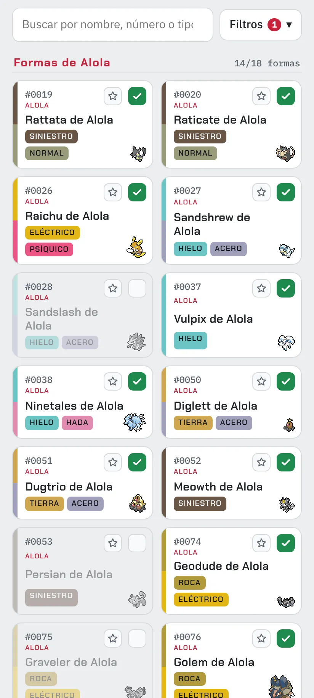

### Español
- Formas regionales (Alola, Galar, Hisui, Paldea) con seguimiento propio y su propio filtro, que incluye las especies que solo evolucionan desde ellas.
- Color de la región de origen en cada tarjeta.

### English
- Regional forms (Alola, Galar, Hisui, Paldea) tracked on their own, with their own filter, which includes the species that only evolve from them.
- Origin-region colour on every card.

---

## v0.5 — Compañero / Partner (05/10/2026)

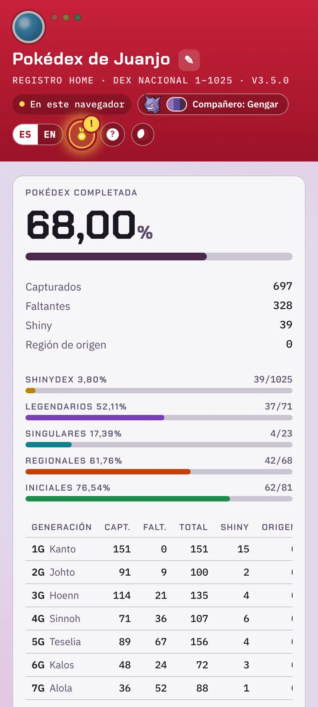 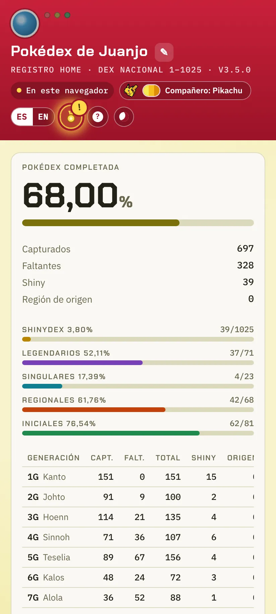

### Español
- Elegí un Pokémon compañero y la página toma sus colores (en modo claro y oscuro).

### English
- Choose a partner Pokémon and the page takes on its colours (in light and dark mode).

---

## v0.4 — Naturalezas / Natures (05/10/2026)

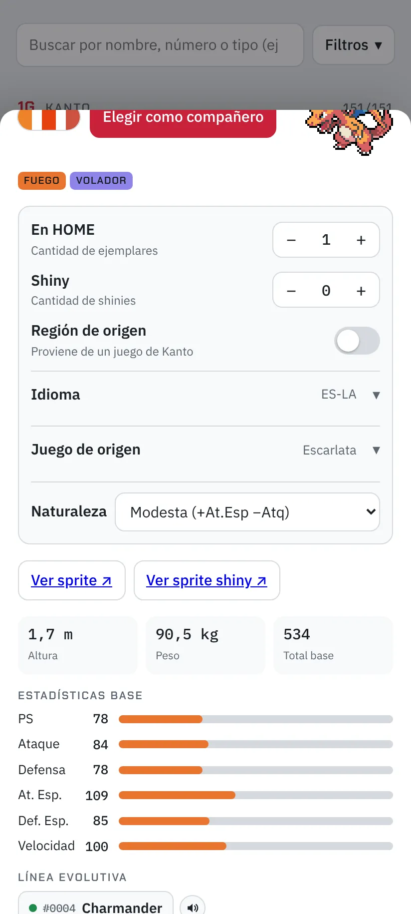

### Español
- Naturaleza de cada Pokémon en la ficha.
- Pokémon Champions agregado a la lista de juegos.
- Contador de la Pokédex elegida (tamaño de la dex y capturados sobre ese total).
- Arreglo: Victini (#000 en las Pokédex de Teselia) aparecía mal en esos filtros.

### English
- Each Pokémon's nature in the entry.
- Pokémon Champions added to the game list.
- Counter for the chosen Pokédex (dex size and caught out of that total).
- Fix: Victini (#000 in the Unova dexes) showed up wrong in those filters.

---

## v0.3 — Tema e idiomas de origen / Theme and origin languages (05/10/2026)

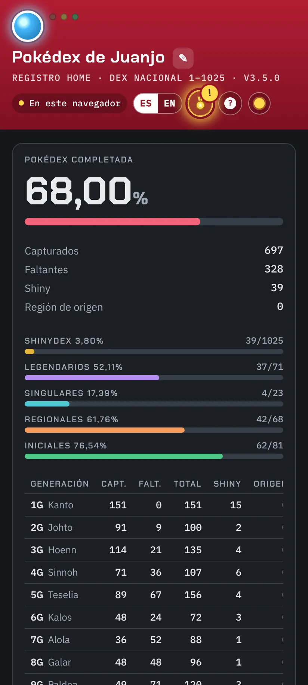

### Español
- Botón para cambiar entre modo claro y oscuro, con mejor contraste.
- Idioma y juego de origen de cada Pokémon.
- Los respaldos y el CSV incluyen los datos nuevos.

### English
- Light/dark mode toggle, with better contrast.
- Each Pokémon's language and origin game.
- Backups and CSV include the new data.

---

## v0.2 — Pokédex regionales / Regional Pokédex (05/10/2026)

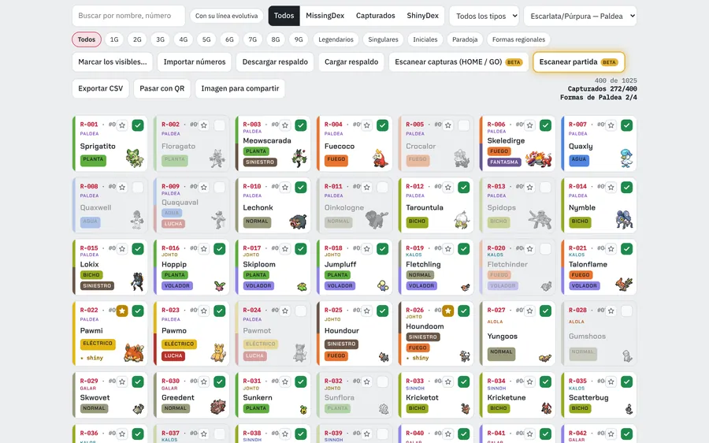

### Español
- Pokédex regional de cada juego como filtro.
- Varias generaciones a la vez en el filtro.
- El filtro de iniciales incluye la línea completa.
- Megaevoluciones y Dinamax/Gigamax en la ficha.
- Respaldo descargable.

### English
- Each game's regional Pokédex as a filter.
- Several generations at once in the filter.
- The starters filter includes the whole line.
- Mega Evolutions and Dynamax/Gigantamax in the entry.
- Downloadable backup.

---

## v0.1 — Primera versión / First version (05/10/2026)

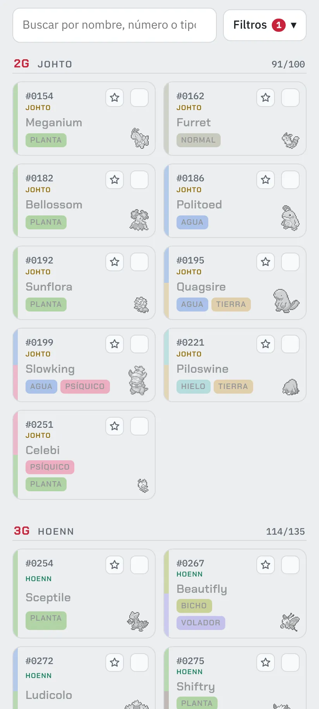 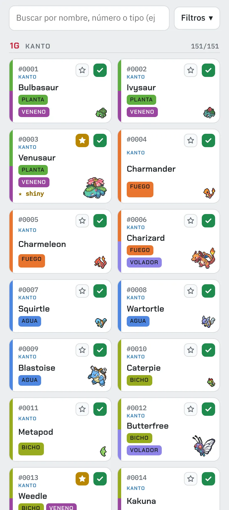

### Español
- Paso de la planilla de Google Sheets a una página web.
- Pokédex Nacional completa (1–1025): capturados, shiny y cantidad en HOME.
- Vistas Todos, MissingDex, Capturados y ShinyDex; filtros por generación y tipo.
- Ficha con línea evolutiva y cómo conseguirlo en Pokémon GO.
- Marcar muchos a la vez, importar números y exportar a CSV.

### English
- Moved from the Google Sheets spreadsheet to a web page.
- Full National Pokédex (1–1025): caught, shiny and count in HOME.
- All, MissingDex, Caught and ShinyDex views; filters by generation and type.
- Entry with evolution line and how to get it in Pokémon GO.
- Bulk marking, number import and CSV export.
